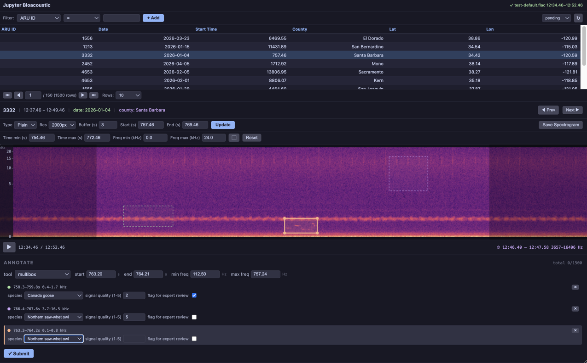
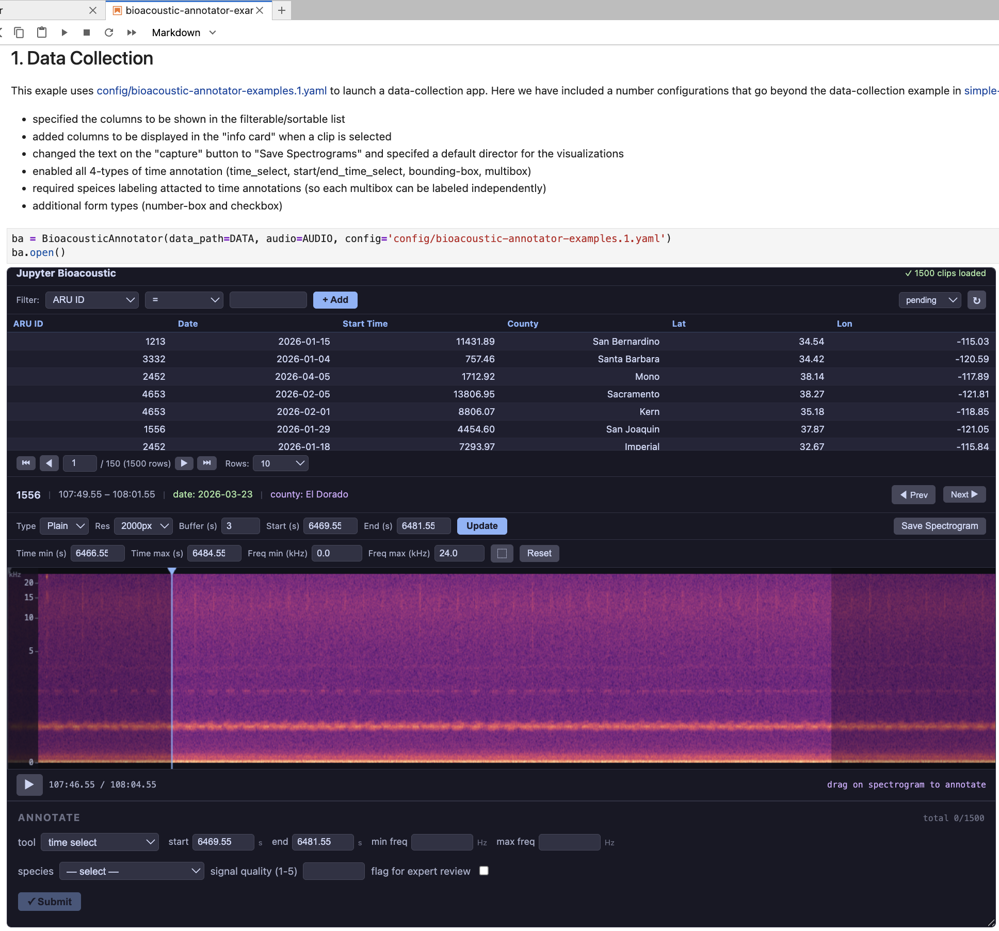

# JupyterBioacoustic

_A JupyterLab plugin for reviewing and annotating bioacoustic audio clips._



**Documentation**
- site:  https://schmidtdse.github.io/jupyter_bioacoustic/
- docs: https://github.com/SchmidtDSE/jupyter_bioacoustic/wiki

**Table of Contents**

- [Install](#install)
- [Quick Start](#quick-start)
- [Features](#features)
- [Documentation](#documentation)
- [Usage](#usage)
- [BioacousticAnnotator Parameters](#bioacousticannotator-parameters)
- [Demo](#demo)
- [License](#license)

---

## Install

```bash
pip install jupyter-bioacoustic
```

Optional extras:

```bash
pip install "jupyter-bioacoustic[gcs]"    # gs:// audio, data and output sync
```

`https://` audio and data loaded from a URL or an `api::` endpoint need `requests`, and SQL (`SELECT ...`) data needs `duckdb`. Install them if you use those sources.

### Remote audio

Remote FLAC and WAV files (`s3://`, `gs://`, `https://`) are read with byte-range requests, so only the clip being played is downloaded and multi-hour recordings open in seconds. Other formats, or a range read that fails, fall back to downloading and caching the whole file. Set `partial_download=False` to always download the whole file. No ffmpeg is needed.

See the [Development wiki](https://github.com/SchmidtDSE/jupyter_bioacoustic/wiki/Development) for building from source.

## Quick Start

```python
from jupyter_bioacoustic import BioacousticAnnotator

BioacousticAnnotator(
    data='detections-test.csv',
    audio='test.flac',
    data_index_column='id',
    info_card_title='[[common_name]]',
    form_config='form-review.yaml',
    output='reviews.csv',
).open()
```



See the [Getting Started guide](https://github.com/SchmidtDSE/jupyter_bioacoustic/wiki/Getting-Started) for test files and more examples.

## Features

- **Player / Visualizer** — browse audio clips with interactive spectrograms and other visualizations (linear, mel, log-frequency, or custom)
- **Configurable Forms** — YAML-driven annotation and review forms with selects, textboxes, checkboxes, and conditional sections
- **Annotation Tools** — fixed-duration windows, time markers, start/end lines, bounding boxes, and multibox (multiple labeled regions per clip)
- **Built-In & Custom Visualizations** — built-in linear and mel spectrograms, log-frequency, bandpass and waveform visualizations. Easily integrate third-party libraries (OpenSoundscape, librosa, SciPy, ...) or write your own
- **Zoom and Capture** — keyboard/mouse zoom, drag-to-pan, zoom-to-selection box, and PNG export
- **Flexible data sources** — CSV, Parquet, JSON, SQL (DuckDB), API endpoints; remote FLAC/WAV audio read by byte range
- **Syncing** — sync local annotation files to remote storage such as S3 and GCS

## Documentation

Full documentation is on the [wiki](https://github.com/SchmidtDSE/jupyter_bioacoustic/wiki):

- [Getting Started](https://github.com/SchmidtDSE/jupyter_bioacoustic/wiki/Getting-Started) — Installation and first usage
- [Configuration](https://github.com/SchmidtDSE/jupyter_bioacoustic/wiki/Configuration) — All parameters, config files, capture, S3, kwargs
- [Configurable Forms](https://github.com/SchmidtDSE/jupyter_bioacoustic/wiki/Configurable-Forms) — YAML form layout reference
- [Annotation Tools](https://github.com/SchmidtDSE/jupyter_bioacoustic/wiki/Annotation-Tools) — Spectrogram interaction tools
- [Data Schema](https://github.com/SchmidtDSE/jupyter_bioacoustic/wiki/Data-Schema) — Input and output formats
- [API Reference](https://github.com/SchmidtDSE/jupyter_bioacoustic/wiki/API-Reference) — `BioacousticAnnotator` class, properties, methods
- [Audio IO](https://github.com/SchmidtDSE/jupyter_bioacoustic/wiki/Audio-IO) — `jupyter_bioacoustic.audio` module reference
- [Demo](https://github.com/SchmidtDSE/jupyter_bioacoustic/wiki/Demo) — Running the demo notebooks
- [Development](https://github.com/SchmidtDSE/jupyter_bioacoustic/wiki/Development) — Project structure, build tasks, architecture

## Usage 

The `BioacousticAnnotator` class has a small interface. The main methods are `.open(inline=True)`, `.output(force=False)` and `.validate()`, and `.source` holds the input data. See the [API Reference](https://github.com/SchmidtDSE/jupyter_bioacoustic/wiki/API-Reference) for the rest (`.sync()`, `.describe()`, `.configuration`, ...).

```python
from jupyter_bioacoustic import BioacousticAnnotator

# Create an instance
ja = BioacousticAnnotator(data='path_to_data.parquet', ...)

# Validate the config (same checks as `jba validate` and the config builder)
# -> {'valid': bool, 'errors': [...], 'warnings': [...]}
ja.validate()

# Open the interface
ja.open()

# Get a dataframe with all the submitted data
# Note: this data is lazy loaded. this will read from
#       file each time you submit.
#       however between submissions it will be cached.
result_df = ja.output()
result_df = ja.output(force=True)  # force re-read from disk

# Dataframe access to the source data (here 'path_to_data.parquet')
ja.source
```

The parameters for `BioacousticAnnotator` are listed [below](#bioacousticannotator-parameters). There is one special parameter `config` that can be used instead of providing the parameter values directly in the notebook. This is a great feature for reproduciblity, organization and avoiding bloated notebooks.  

Consider the example above:


```python
BioacousticAnnotator(
    data='detections-test.csv',
    audio='test.flac',
    data_index_column='id',
    info_card_title='[[common_name]]',
    form_config='form-review.yaml',
    output='reviews.csv',
)
```

This can instead be produced this way

```python
BioacousticAnnotator(
    data='detections-test.csv',
    config='config/review-configuration.yaml',
).open()
```

```yaml
# config/review-configuration.yaml
audio: 'test.flac'
data_index_column: 'id'
info_card_title: '[[common_name]]'
form_config: 'form-review.yaml'
output: 'reviews.csv'
```

For this simple example, this might not seem helpful. However for more advanced configurations this is quite useful.  Moreover, in the example above the review-form has a configuration file `form-review.yaml`. If using `config` the form can be included directly.

See [Configuration](https://github.com/SchmidtDSE/jupyter_bioacoustic/wiki/Configuration) for full details. Here is an advanced example:

```yaml
# BioacousticAnnotator Args
audio: "audio_path"    # column name — auto-detected (no slashes or dots)
data_index_column: id  # required whenever there is a form
display_columns: ["common_name", "confidence", "start_time", "county", "audio_path"]
info_card_title: '[[common_name]]'
info_card_text: '[[confidence]] | [[county]] | [[start_time]]'
capture: 'Save Spectrogram'
capture_dir: 'spectrograms'


# Form
form_config:
  title:
    value: 'REVIEW CLIP'
    progress_tracker: true
  form:
    - select:
        label: Is Valid
        column: is_valid
        required: true
        items:
          - label: 'yes'
            value: 'yes'
          - label: 'no'
            value: 'no'
            form: correction_form   # shown when "no" is selected
    - textbox:
        label: notes
        column: notes
  annotation:
    tools: start_end_time_select
  dynamic_forms:
    correction_form:
      - select:
          label: verified name
          column: verified_common_name
          required: true
          items:
            path: data/categories.csv
            value: common_name
      - select:
          label: verif. confidence
          column: verification_confidence
          items:
            - low
            - medium
            - high
  submission_buttons:
    line: true
    next:
      label: Skip
    submit:
      label: Verify
```

### BioacousticAnnotator Parameters

| Parameter | Type | Default | Description |
|---|---|---|---|
| `data` | DataFrame / str / dict | *required** | Input data. String: file path (CSV, Parquet, JSON), URL, `api::url`, or SQL (`SELECT ...`). Dict: `{value(+source_type)\|path\|url\|uri\|api\|sql, secrets, columns, index_column, start_time, end_time, duration}`. |
| `data_source_type` | str | `None` | How to read `data_value`: `path`, `url`, `sql` or `api`. Omitted ⇒ auto-detect. |
| `data_value` | str | `None` | Data source string, read according to `data_source_type`. |
| `data_path` | str | `None` | Explicit file path for data (overrides `data` source). |
| `data_url` | str | `None` | Explicit URL for data (overrides `data` source). |
| `data_sql` | str | `None` | Explicit SQL query for data (overrides `data` source). |
| `data_api` | str | `None` | Explicit API endpoint for data (overrides `data` source). |
| `data_index_column` | str | `None` | Column that uniquely identifies each input row. **Required when a form is configured.** |
| `data_start_time` | str | `'start_time'` | Column with clip start times (seconds). |
| `data_end_time` | str | `'end_time'` | Column with clip end times (seconds). |
| `data_duration` | str / number | `None` | Column, or a fixed number of seconds, for clip duration (instead of `data_end_time`). |
| `data_secrets` | dict, list, or `false` | `None` | Auth for data loading. `{key, value}` pairs. Value: `env:VAR`, `dialog`, or literal. Set to `false` to opt out of global `secrets` fallback. |
| `display_columns` | list | `[]` | Columns for the clip table. |
| `sort` | str | `None` | Column to sort the clip table by (`None` keeps input order). |
| `sort_order` | str | `'asc'` | `'asc'` or `'desc'`. |
| `audio` | str or dict | *required** | Audio source. String: local path, URL/URI, or column name (auto-detected). Dict: `{value(+source_type)\|path\|url\|uri\|column\|sql\|api, prefix, suffix, fallback, secrets, property, response_index}`. |
| `audio_source_type` | str | `None` | How to read `audio_value`: `path`, `url`, `uri`, `column`, `sql` or `api`. Omitted ⇒ auto-detect. |
| `audio_value` | str | `None` | Audio source string, read according to `audio_source_type`. |
| `audio_path` | str | `None` | Explicit local file path for audio (overrides `audio` source). |
| `audio_url` | str | `None` | Explicit URL for audio (overrides `audio` source). |
| `audio_uri` | str | `None` | Alias for `audio_url`. |
| `audio_column` | str | `None` | Explicit column name for per-row audio (overrides `audio` source). |
| `audio_prefix` | str | `''` | Prefix joined with `/` to audio paths. |
| `audio_suffix` | str | `''` | Suffix joined with `/` to audio paths. |
| `audio_fallback` | str | `''` | Fallback when `audio` is a column and the row value is empty. |
| `audio_secrets` | dict, list, or `false` | `None` | Auth for audio loading (same format as `data_secrets`). Set to `false` to opt out of global `secrets` fallback. |
| `audio_sql` | str | `None` | SQL query to resolve audio path. Requires `audio_property`. |
| `audio_api` | str | `None` | API URL to resolve audio path. Requires `audio_property`. |
| `audio_property` | str | `None` | Field/column to extract from SQL/API response as the audio path. |
| `audio_response_index` | int | `1` | 1-based row index for SQL/API response (1 = first row). |
| `secrets` | dict or list | `None` | Global auth — fallback for `data_secrets`, `audio_secrets`, and `output_secrets`. Each can opt out by setting to `false`. |
| `output` | str or dict | `''` | Output file path or sync config dict. String: local path. Dict: `{path, uri/url, sync_button, recursive, secrets, index_column}`. Without one, a form writes to `outputs/annotation_output-<timestamp>.csv`. See [Output & Sync](https://github.com/SchmidtDSE/jupyter_bioacoustic/wiki/Configuration#output-parameters). |
| `output_path` | str | `None` | Explicit local output file path (overrides `output` string or `output.path` dict key). |
| `output_url` | str | `None` | Remote sync destination (overrides `output.uri`/`output.url` dict key). |
| `output_uri` | str | `None` | Alias for `output_url`. |
| `output_sync_button` | bool / str | `None` | Show a sync button (`true` = "Sync", string = custom label). |
| `output_recursive` | bool | `None` | Passed to `io.write()` for uploading directories. |
| `output_secrets` | dict, list, or `false` | `None` | Auth for sync uploads (same format as `data_secrets`). Set to `false` to opt out of global `secrets` fallback. |
| `output_index_column` | str | `data_index_column` | Name of the row-identifier column in the output file. |
| `project` | str / dict | `None` | Project file path (or dict). No other config params allowed when set. |
| `project_name` | str | `None` | Widget header title. Auto-derived from project filename if not set. |
| `config` | str / dict | `None` | Path to a YAML/JSON config file (or dict). |
| `form_config` | dict / str | `None` | Form layout — YAML file, dict, or `None` for no form. |
| `description` | str / dict | `None` | Collapsible description panel: markdown text, a `.md`/`.txt` path, or `{title, text, path, open, height}`. |
| `description_title`, `description_text`, `description_path`, `description_open`, `description_height` | | `None` | The `description` dict keys as separate parameters. |
| `info_card_title` | str | `''` | Info card title — supports `[[column_name]]` templates. Also used for capture filenames. |
| `info_card_text` | str | `''` | Info card text — supports `[[column_name]]` templates. |
| `duplicate_entries` | bool | `False` | Allow multiple submissions per row |
| `default_buffer` | int / float | `3` | Default buffer time in seconds around each clip |
| `capture` | bool / str | `True` | Capture button (`False` to hide, string for custom label) |
| `capture_dir` | str | `''` | Directory prefix for captures |
| `capture_height` | int | `None` | Capture image height in pixels. Defaults to `player_height` if not set. |
| `spectrogram_resolution` | int / list | `[1000, 2000, 4000]` | Spectrogram width in pixels. List for a dropdown selector, single value for fixed. Prefix an item with `selected::` to set the default (e.g. `[1000, 'selected::2000', 4000]`). |
| `visualizations` | list | `['linear', 'mel']` | Visualization types for the dropdown. Built-in strings (`'linear'`, `'mel'`, `'log_frequency'`, `'bandpass'`, `'waveform'`) or custom callables. See [Custom Visualizations](https://github.com/SchmidtDSE/jupyter_bioacoustic/wiki/Configuration#custom-visualizations). |
| `partial_download` | bool | `True` | Read only the clip's bytes from remote FLAC/WAV audio. Set to `False` to always download and cache the full file. |
| `width` | str / int | `'100%'` | Widget width (pixels or a percentage string). |
| `clip_table_height` | int | `175` | Clip table height in pixels. |
| `player_height` | int | `260` | Player/spectrogram height in pixels. |
| `info_card_height` | int | `34` | Info card height in pixels. |
| `form_panel_height` | int | `175` | Form panel height in pixels. |
| `session_args` | list / bool | `None` | Which `**kwargs` are allowed: a list of names, `True` (all) or `False` (none). |
| `**kwargs` | | | Fixed columns in every output row. A name close to a real parameter (e.g. `sort_ordr`) gives a "Did you mean" warning. |

> \* `data` is not required if `data_value`, `data_path`, `data_url`, `data_sql`, or `data_api` is provided. `audio` is not required if `audio_value`, `audio_path`, `audio_url`, `audio_uri`, `audio_column`, `audio_sql`, or `audio_api` is provided.

## Demo

Example notebooks are included in the `demo/` directory. They require additional dependencies (ipyleaflet, shapely, seaborn, requests).

### 1. Install with demo dependencies

**With pixi:**
```bash
cd demo
pixi run -e demo jba lab
```
This launches JupyterLab inside the `demo` pixi environment with the data-rate limit pre-configured.

**With pip:**
```bash
pip install -e ".[demo]"
jupyter lab --ServerApp.iopub_data_rate_limit=1e10
```

### 2. Download audio files (one-time)

Audio files are not included in this repository (they are large FLAC files, ~50-100 MB each).

> **These are large files. It will likely take multiple minutes per file to download.** For demo purposes, you can replace them with any FLAC audio file — the spectrograms will look different but the plugin works the same way.

**With AWS CLI (faster):**

```bash
cd demo
mkdir -p audio
aws s3 cp s3://dse-soundhub/public/audio/dev/20230522_200000.flac audio/test-default.flac --no-sign-request &
aws s3 cp s3://dse-soundhub/public/audio/dev/20230524_200000.flac audio/test1.flac --no-sign-request &
aws s3 cp s3://dse-soundhub/public/audio/dev/20230525_200000.flac audio/test2.flac --no-sign-request &
aws s3 cp s3://dse-soundhub/public/audio/dev/20230526_000000.flac audio/test3.flac --no-sign-request &
wait
```

**With curl:**

```bash
cd demo
mkdir -p audio
curl -o audio/test-default.flac https://dse-soundhub.s3.us-west-2.amazonaws.com/public/audio/dev/20230522_200000.flac
curl -o audio/test1.flac https://dse-soundhub.s3.us-west-2.amazonaws.com/public/audio/dev/20230524_200000.flac
curl -o audio/test2.flac https://dse-soundhub.s3.us-west-2.amazonaws.com/public/audio/dev/20230525_200000.flac
curl -o audio/test3.flac https://dse-soundhub.s3.us-west-2.amazonaws.com/public/audio/dev/20230526_000000.flac
```

### 3. Open a demo notebook

Open `simple-examples.ipynb` from the JupyterLab file browser. The notebook demonstrates both review and annotation workflows.

## License

BSD 3-Clause
